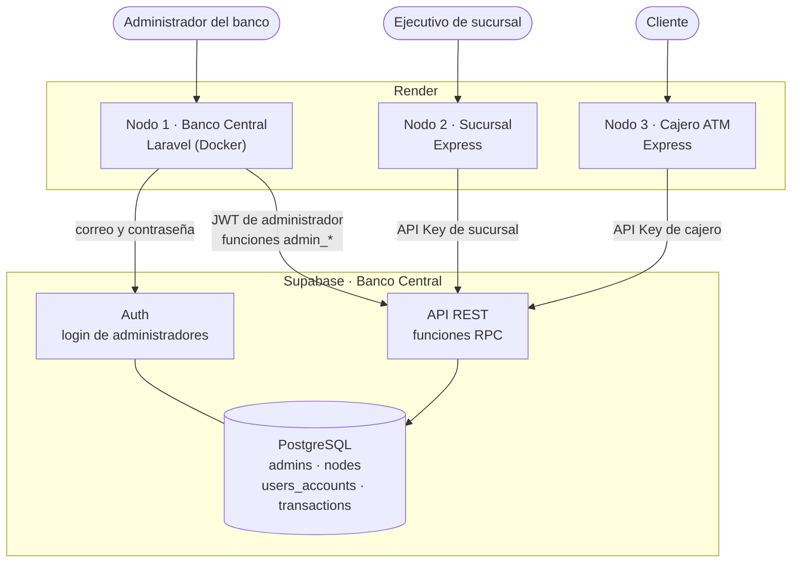
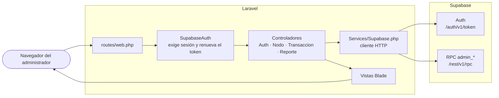
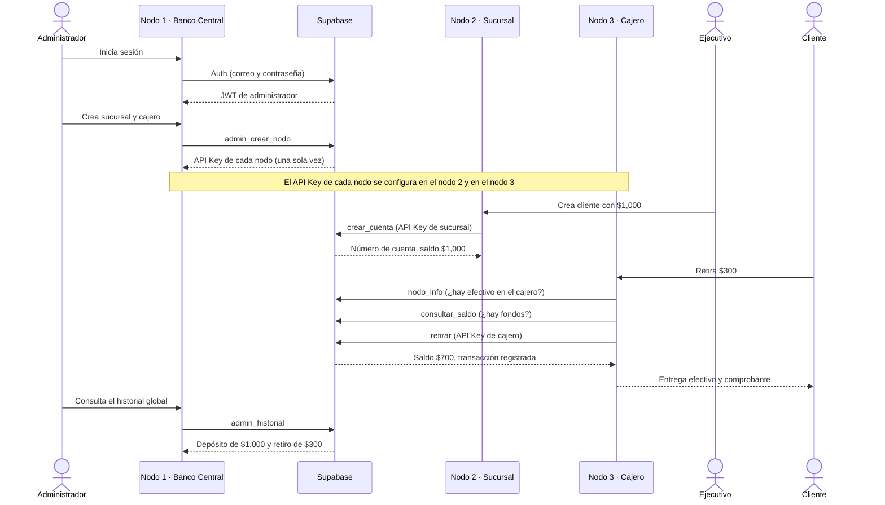
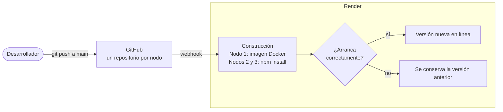

# Nodo 1 · Banco Central

Panel de administración del **Sistema Bancario Distribuido** (Examen 2 Práctico).
Aquí vive la base de datos central y desde aquí se dan de alta las sucursales y los cajeros.

## Enlaces

| Nodo | Aplicación desplegada | Tecnología |
|---|---|---|
| **1 · Banco Central** | https://examen2-tawd-nodo1.onrender.com | Laravel + Supabase |
| 2 · Sucursal | https://examen2-tawd-nodo2.onrender.com | Express |
| 3 · Cajero automático | https://examen2-tawd-nodo3.onrender.com ([panel](https://examen2-tawd-nodo3.onrender.com/admin)) | Express |

Las aplicaciones están en el plan gratuito de Render: si llevan un rato sin uso,
la primera carga tarda cerca de un minuto.

## Arquitectura del sistema

Los tres nodos son aplicaciones independientes. Ninguno guarda saldos: todos consultan
y modifican la única base de datos, que está en Supabase.



### Reglas de seguridad

- **Sin acceso directo a tablas.** RLS niega todo al rol público; los nodos solo pueden
  llamar funciones RPC.
- **API Key por nodo.** Cada sucursal y cajero se identifica con su propio API Key. En la
  base solo se guarda su hash SHA-256, por eso se muestra una única vez al crearlo.
- **Operaciones atómicas.** `retirar`, `depositar` y `transferir` validan el API Key,
  verifican saldo y efectivo, actualizan el saldo y registran la transacción en un solo paso.
- **Transacciones inmutables.** Un trigger rechaza cualquier `UPDATE`, `DELETE` o
  `TRUNCATE` sobre `transactions`.

## Arquitectura del nodo 1



El panel no tiene base de datos propia: no hay migraciones, y las sesiones y la caché
se guardan en archivos.

| Función del panel | Pantalla | Función en Supabase |
|---|---|---|
| Crear sucursales y cajeros con su API Key | Sucursales y cajeros | `admin_crear_nodo`, `admin_regenerar_api_key` |
| Efectivo disponible y responsables | Sucursales y cajeros → Editar | `admin_actualizar_nodo` |
| Activar o desactivar un nodo | Sucursales y cajeros | `admin_cambiar_estado` |
| Historial global por sucursal o cajero | Historial | `admin_historial` |
| Reportes administrativos (CSV y PDF) | Reportes | `admin_reporte` |

## Flujo de la aplicación

Recorrido completo, de la creación de los nodos a un retiro en el cajero:



1. **Alta de nodos.** El administrador inicia sesión en el nodo 1 y crea una sucursal y
   un cajero. Supabase devuelve un API Key para cada uno.
2. **Conexión.** Cada API Key se configura en su nodo: en el nodo 2 (pantalla
   Configuración) y en el nodo 3 (panel `/admin`). El nodo lo verifica contra el banco.
3. **Alta de cliente.** El ejecutivo crea una cuenta en la sucursal. El depósito inicial
   queda registrado como transacción y suma al efectivo de la sucursal.
4. **Retiro.** El cajero revisa primero sus reglas locales y su efectivo, luego el saldo
   del cliente, y solo entonces pide el retiro al banco.
5. **Supervisión.** El administrador ve todos los movimientos en el historial global y
   en los reportes, filtrados por sucursal o cajero.

## Pipeline de despliegue (CI/CD)

Los tres repositorios están conectados a Render con despliegue automático: cada `git push`
a `main` construye y publica la versión nueva sin pasos manuales.



| Nodo | Entorno en Render | Construcción | Arranque |
|---|---|---|---|
| 1 · Banco Central | Docker (`Dockerfile`) | `composer install` dentro de la imagen | Apache + PHP 8.4 |
| 2 · Sucursal | Node | `npm install` | `npm start` |
| 3 · Cajero | Node | `npm install` | `npm start` |

Las claves (Supabase, API Keys de los nodos, contraseñas) no están en los repositorios:
se definen como variables de entorno en Render.

## OpenAPI

[`openapi.yaml`](openapi.yaml) documenta la API del Banco Central: el inicio de sesión,
las funciones de administración (`admin_*`) y las operaciones que usan los nodos 2 y 3
(`crear_cuenta`, `consultar_saldo`, `retirar`, `depositar`, `transferir`, `historial`).

Para verlo como documentación interactiva, abrir https://editor.swagger.io y pegar el
contenido del archivo.

## Base de datos

Los scripts están en [`supabase/`](supabase/) y se ejecutan en el SQL Editor, en este orden:

1. `banco_central.sql`: tablas, RLS, trigger de inmutabilidad y funciones de operación.
2. `banco_central_02_panel.sql`: funciones `admin_*` que usa este panel.

| Tabla | Contenido |
|---|---|
| `admins` | Usuarios de Supabase Auth con acceso al panel |
| `nodes` | Sucursales y cajeros: tipo, responsable, efectivo disponible, estado y hash del API Key |
| `users_accounts` | Cuentas de clientes: número, titular y saldo |
| `transactions` | Retiros, depósitos y transferencias, con el nodo donde ocurrieron |

## Ejecución local

Requiere PHP 8.3 o superior y Composer.

```bash
composer install
cp .env.example .env
php artisan key:generate
php artisan serve
```

En `.env` se definen `SUPABASE_URL` y `SUPABASE_ANON_KEY` (clave anon, nunca la `service_role`).